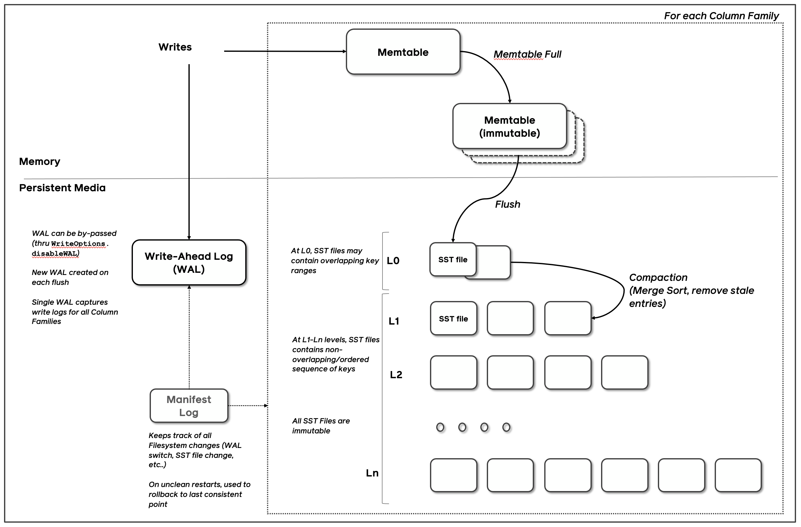

# rocksdb quick start

## 1. 它到底是什么？

RocksDB 不是像 MySQL、PostgreSQL、MongoDB 那样的独立数据库服务，RocksDB没有客户端-服务器架构、没有端口、没有 SQL。

RocksDB 数据库的名称对应于一个文件系统目录。数据库的所有内容都存储在该目录中。

它是一个嵌入式持久化 Key-Value 存储库（C++ 写的），由 Facebook（Meta）在 Google LevelDB 基础上深度优化而来。程序员把它编译进自己的程序，直接在进程内调用 API。

核心特点：

- **数据模型**：纯 Key-Value（key 和 value 都是任意字节数组），key 默认按字典序排序。
- **存储引擎**：基于 LSM-Tree、（Log-Structured Merge-Tree），对写密集型场景非常友好。
- **设计目标**：针对 SSD / 闪存优化，高吞吐、低延迟，支持 TB 级数据。

数据库对比：

| 维度     | MySQL / PostgreSQL | MongoDB       | RocksDB                           |
| -------- | ------------------ | ------------- | --------------------------------- |
| 架构     | 客户端-服务器      | 客户端-服务器 | 嵌入式库                          |
| 查询语言 | SQL                | 文档查询      | 纯 API（Get/Put/Delete/Iterator） |
| 数据模型 | 关系 / 文档        | 文档          | 纯 KV                             |
| 写优化   | B+ 树（随机写）    | 混合          | LSM（顺序写）                     |
| 事务     | 完整 ACID          | 文档级        | 支持（TransactionDB）             |
| 部署     | 独立进程           | 独立进程      | 和你的程序同进程                  |

## 2. 核心概念

### MemTable

内存里的写缓冲。新写入先放这里，读的时候也最先查这里。

- 默认是跳表（skiplist）：数据有序，写入和范围扫描可以交错进行。
- 写满后变成只读的 immutable memtable，后台把它刷成 SST；新写入同时进一块新的 memtable。
- 可以配多块 memtable 排队刷盘：新的继续收写，旧的在后台刷。慢盘上这样写得更快。
- 刷盘时顺手清垃圾：同一个 key 只留最新值；被后面的 Delete 盖住的旧值直接不写出。

### WAL

保证持久性的预写日志。`Put` / `Delete` / `Merge` 进 memtable 的同时，可选地追加到 WAL。崩溃重启时重放这段日志，把还没刷成 SST 的写入找回来。

- 整库所有列族共用一份 WAL。每刷一次 memtable，就换一份新 WAL，旧的可以删。
- `WriteOptions.disableWAL` 可以跳过它：更快，但崩溃会丢掉还在内存里的数据。
- 可以用 `WriteOptions` 决定提交前要不要 `fsync`。内部会把多笔写攒成一批，尽量一次 `fsync` 提交。

### SST（Sorted String Table）

MemTable 满后刷盘变成的不可变排序文件。里面的 key 排好序，方便查找。写出之后不再修改；更新和删除都是另写一条新记录，旧文件等 compaction 再替换掉。

- 默认格式是 BlockBasedTable：数据切成 block（通常 4KB–128KB），每块带校验和，用来发现磁盘损坏。
- L0 里多个 SST 的 key 范围可能重叠；L1 及以下，每一层内部的 key 不重叠。

### Compaction

后台把多层 SST 合并、清掉被覆盖或已删除的旧版本，让数据重新排好。它控制两件事：磁盘别比真实数据大太多（空间放大），读一个 key 别翻太多文件（读放大）。

这里的「压缩」是合并整理，不是 lz4 / zstd 那种数据压缩。

- 写得越快，compaction 越要跟得上，否则 memtable 堆满，新写入会被卡住。
- 可以多线程一起做。数据在 SSD 上时，多线程的持续写入速度可以比单线程高出一个数量级。
- 可以单独留几个后台线程只负责刷 memtable，避免它们全去跑耗时的 compaction，把写入堵住。

### Bloom Filter

每个 SST 带一个布隆过滤器。点查时先问「这个 key 可能在这个文件里吗」，明确没有就跳过，少做磁盘 IO。

如果配置了 `prefix_extractor`，前缀的哈希也会放进 Bloom。按前缀扫描时，可以跳过不含该前缀的文件。

### Block Cache

读路径上的 LRU 缓存，缓存 SST 里的数据块，避免同一个块反复读盘、解压。

分成两份：一份是解压后的块，一份是仍为压缩形态的块。开了压缩块缓存时，常常配合 Direct I/O，避免操作系统页缓存里再存一份同样的数据。

### 写入路径简化

```
Put → WAL + MemTable
    → MemTable 满，变成 Immutable MemTable
    → Flush 成 L0 SST（对应 WAL 可删）
    → Compaction 合并到 L1…Ln（去掉旧版本）
```

读一个 key 则反过来，从新到旧：

```
活跃 MemTable → Immutable MemTable → L0 → L1 → … → Ln，先碰到的就是最新值。
```

### LSM

磁盘上的 SST 按层摆放，新数据在上层，老数据在下层。这就是 LSM（Log-Structured Merge-Tree）：写入尽量变成顺序写，而不是在磁盘上原地改旧数据。

- **L0**：刚从 memtable 刷下来。文件之间 key 范围可以重叠，查一个 key 可能要看多个文件。
- **L1–Ln**：每层内部 key 不重叠，基本是一路排好序的数据。层号越大，数据越老。
- 所有 SST 都不可变。改一个 key 不会改旧文件，而是写一条更新的记录；读的时候从新到旧找。

### Level-stype和Universal-style的区别

两种都把数据放在固定的若干层里：新的在 L0，老的在更高层。L0 的文件 key 可以重叠，其它层一般每层是一路有序数据。差别在 compaction 怎么合并，以及你更想省哪种放大。

|        | Level（默认）                                      | Universal                                      |
| ------ | -------------------------------------------------- | ---------------------------------------------- |
| 优先省 | 空间放大：磁盘占用接近真实数据量                   | 写放大：尽量少往磁盘写字节                     |
| 怎么合并 | 每次拿 Ln 的一个文件，和 Ln+1 里重叠的文件合并，结果写回 Ln+1 | 一次可以合并很多文件，并且跨多层               |
| 代价   | 同一份数据会被反复重写，写放大更高                 | 临时空间更大，空间放大和读放大通常更高         |
| 适合   | 磁盘紧、读比较多、希望文件规整                     | 写很猛，而且能多留一些磁盘                     |

Level 用更多写入换更小的盘和更规整的读；Universal 用更多磁盘空间换更少的写入。

### Column Families

一个 DB 里可以划出多块独立的 key 空间，类似多张表，但更轻。建库时一定有一个叫 `default` 的列族，没指定列族的操作都进它。

每个列族有自己的 memtable 和各层 SST，整库共用一份 WAL。

开了 WAL，或者开了原子刷盘（atomic flush）时，崩溃恢复之后，各列族看到的仍是同一份一致数据。`WriteBatch` 还可以一次原子地改多个列族：要么全成功，要么全不写。

### Get

key 和 value 都是任意字节，没有长度上限。

- `Get`：按一个 key 取值。
- `MultiGet`：一次取多个 key。

### Transactions

普通 `WriteBatch` 已经能让一批 key 要么全写上、要么全不写。事务在这之上多做一件事：有冲突就整批不写。提交之前，别的线程看不到这些修改。用法是 Begin / Commit / Rollback。

打开方式有两种，对应两种并发控制。

**悲观：`TransactionDB`**

写入时就给 key 加锁。锁不上就返回错误。只要数据库还能写，`Commit` 一定会成功。事务外面的 `Put` / `Delete` / `Merge` 也会做冲突检查。锁的超时和上限在 `TransactionDBOptions` 里调。

经常有人同时改同一批 key 时用它。代价是每笔写都有一点加锁开销。默认写入策略是 `WriteCommitted`，还可以选 `WritePrepared`、`WriteUnprepared`。

**乐观：`OptimisticTransactionDB`**

准备写入时不加锁。`Commit` 时才检查这些 key 有没有被别人改过。有冲突，或者当时判断不了，`Commit` 失败，一个 key 都不会写入。

适合只是偶尔撞车。很多人反复改同一批 key 时不合适，应改用 `TransactionDB`。普通写入很多、事务很少时，乐观通常更快。

**读到自己还没提交的写**

事务里的 `Get` / `MultiGet` 能看到本事务已经写入、但还没提交的值；没改过的 key 仍是库里的旧值。`GetIterator()` 可以同时扫库里的数据和当前事务里的修改。

**读写冲突要显式声明**

普通 `Get` 不参与冲突检查。别人随后改了这个 key，事务仍然可以提交。

`GetForUpdate` 把读到的值当成提交条件：

- 悲观：事务外再写这个 key 会堵住或超时，直到本事务提交或回滚。
- 乐观：事务外的写可以成功，但本事务的 `Commit` 会失败。

目前只有 `GetForUpdate` 能建立这种读写冲突，范围扫描要保护某个 key 时也靠它。

**冲突从什么时候算起**

默认只看「本事务第一次写这个 key」之后有没有别人写过。在那之前被别人写过，不算冲突。

调用 `SetSnapshot()` 之后，起点改成拍快照的那一刻（通常就是事务开始）。快照之后别人写过这个 key，即使发生在你自己写入之前，也不允许提交。悲观时那次外部写入会失败；乐观时是 `Commit` 失败。

### Iterator

全库的 key 按顺序排好，排序规则可以自己指定。

`Iterator` 用来做范围扫描：先定位到某个 key，再一条一条往下读，也可以反向扫。创建它的那一刻就固定了一份当时的一致视图，后面扫到的都是这一刻的数据。

它会抓住这份视图用到的底层文件，Iterator 释放之前这些文件不会被删。所以它适合短、前台的扫描。长时间的后台扫描更适合下面的 Snapshot。

### Snapshot

给数据库拍一张时间点视图。之后可以用 `Get` 和 `Iterator` 读这张快照里的数据。

和 Iterator 的差别：Snapshot 不阻止删文件。compaction 知道还有哪些快照活着，承诺不删掉任何快照里还能看见的 key。

快照不跨重启。进程重新加载 RocksDB 之后，之前的 Snapshot 全部失效。

## 3. 架构



一条写入在图里的去向：

1. 同时进两处：当前列族的 Memtable，以及全库共用的 WAL。WAL 可以用 `disableWAL` 跳过。
2. Memtable 写满后变成 Immutable Memtable，后台 Flush 成 L0 SST。每次 flush 会换一份新 WAL。
3. L0 的 SST 之间 key 范围可能重叠。Compaction 做归并、去掉过期记录，把数据推到 L1、L2 …… Ln。L1 及以下每层内部 key 不重叠。
4. 所有 SST 一旦写出就不可变。
5. MANIFEST 记下每一次文件变更（WAL 切换、SST 增删）。异常重启时靠它回到最近一个一致点。

虚线框是「每个列族一份」：memtable 和各层 SST 按列族分开；WAL 和 MANIFEST 是整库一份。

## 4. 基本结构

RocksDB 的三个基本构件是 memtable、sstfile 和 logfile。

### 4.1 memtable

内存数据结构。新写入插进 memtable，并可选地写进 logfile（WAL）。

默认实现是跳表。库里还带了两种替代：vector 适合批量导入（先往后追加，刷盘前再排序）；prefix-hash 适合按 key 前缀做点查和短扫描。

### 4.2 sstfile

memtable 写满后刷到磁盘上的文件，数据按 key 排序，方便查找。默认格式见 [BlockBasedTable](https://github.com/facebook/rocksdb/wiki/Rocksdb-BlockBasedTable-Format)。文件写出后不再修改。

### 4.3 logfile

顺序追加的 WAL 文件。memtable 成功刷成 sstfile 之后，对应的 logfile 就可以安全删除。重启时重放还没删掉的 logfile，恢复那些只在内存里、还没刷盘的写入。
